# Diagrammes UML

Les diagrammes sont écrits en **Mermaid** : ils s'affichent directement sur GitHub, dans VS Code
(extension « Markdown Preview Mermaid Support ») et dans IntelliJ. Pour exporter une image :
coller le bloc sur <https://mermaid.live>.

Légende : `<<abstract>>` classe abstraite · `<<interface>>` interface · `<<enumeration>>` enum ·
`-->` association · `*--` composition (le tout possède la partie) · `o--` agrégation ·
`<|--` héritage · `<|..` implémentation · `..>` dépendance.
Visibilité : `+` public · `#` protégé · `-` privé · `~` package-private.

Sommaire

1. [Vue d'ensemble des packages](#1-vue-densemble-des-packages)
2. [Hiérarchie des entités](#2-hiérarchie-des-entités)
3. [Joueur et capacités](#3-joueur-et-capacités)
4. [Ennemis](#4-ennemis)
5. [Monde, projectiles, collisions](#5-monde-projectiles-collisions)
6. [Écrans et gestion du temps](#6-écrans-et-gestion-du-temps)
7. [Rendu et effets](#7-rendu-et-effets)
8. [Interface et réglages](#8-interface-et-réglages)
9. [Diagramme d'états : IA ennemie](#9-diagramme-détats--ia-ennemie)
10. [Diagrammes de séquence](#10-diagrammes-de-séquence)
11. [Extension prévue : boss final](#11-extension-prévue--boss-final)

---

## 1. Vue d'ensemble des packages

Base : `fr.epitech.katanagame`. La flèche va de « utilise » vers « utilisé ».

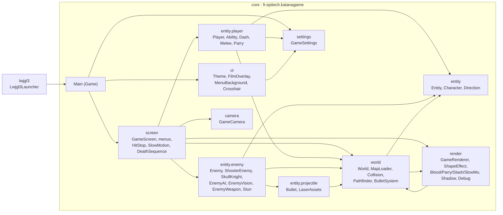

Deux cycles volontaires : `world ↔ render` (le `World` possède les effets visuels, le `GameRenderer` lit le `World`)
et `entity.* → world` (les entités reçoivent le `World` en paramètre de `update`). Le `World` joue le rôle de **façade**
du contexte de jeu (voir `PATTERNS.md`).

---

## 2. Hiérarchie des entités

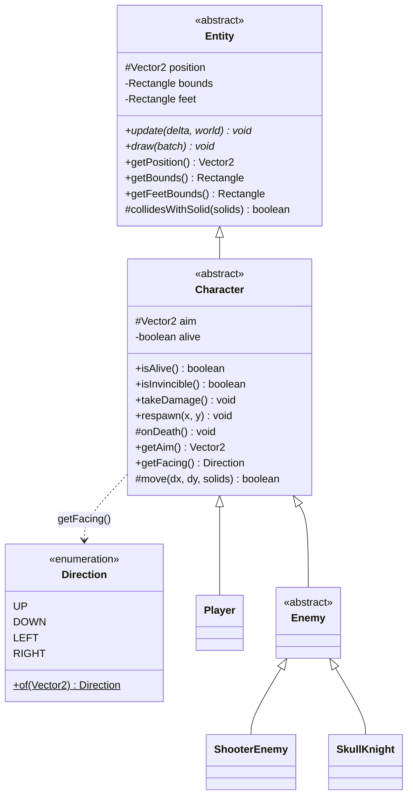

- **Deux hitbox par entité** : `bounds` (corps entier → dégâts) et `feet` (pieds → collisions murs). C'est ce qui permet
  de passer « derrière » un mur en vue top-down.
- **Un coup = mort** est décidé une seule fois, dans `Character.takeDamage()`. `isInvincible()` (dash) et `onDeath()`
  sont les points d'extension.
- `Bullet` n'est **pas** une `Entity` : un projectile n'a ni pieds ni état vivant/mort au sens de `Character`.

---

## 3. Joueur et capacités

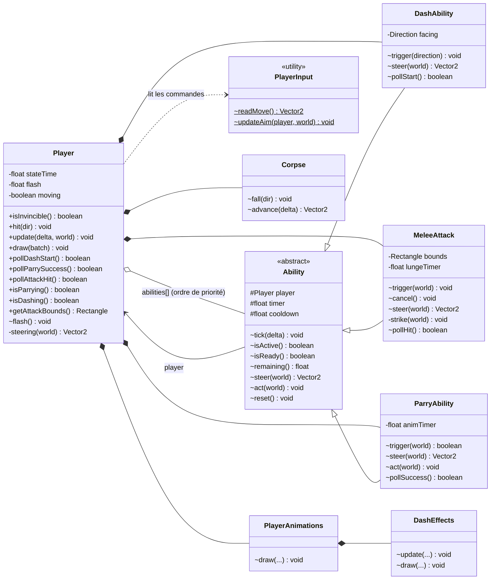

Principe : `Player` **compose** ses capacités au lieu de tout contenir. Chaque tour, `Player.update` :

1. fait avancer les minuteurs (`Ability.tick`),
2. demande à la première capacité qui le souhaite d'**imposer un déplacement** (`Ability.steer`) — priorité dash > coup > parry,
3. applique l'effet continu du parry (`ParryAbility.act`).

Les `poll…()` sont des **drapeaux à lecture unique** (ils renvoient vrai une fois puis se remettent à faux) : c'est ainsi que
`GameScreen` apprend qu'un dash a démarré ou qu'un parry a réussi, sans que `Player` connaisse la caméra ni le `HitStop`.

---

## 4. Ennemis

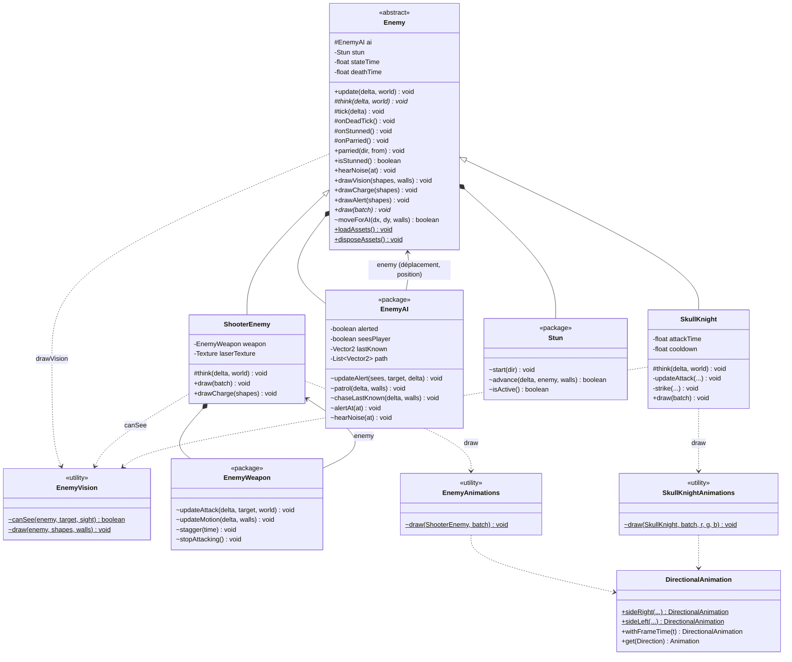

**Qui fait quoi ?** `Enemy` possède le cycle de vie commun et délègue :

| Préoccupation | Classe |
|---|---|
| Perception (voir, alerte, mémoire) | `EnemyVision` + `EnemyAI.updateAlert` |
| Déplacement (patrouille, poursuite A\*) | `EnemyAI` + `Pathfinder` |
| Réaction au parry | `Stun` + hook `onParried()` |
| Attaque propre au type | sous-classe (`think`) + `EnemyWeapon` pour le tireur |
| Rendu | `*Animations` (classes utilitaires, pas de logique de jeu) |

Le **cycle `update`** de `Enemy` est une *Template Method* : l'ordre `stateTime → mort ? → tick → sonné ? → think` est figé
dans `Enemy`, les sous-classes ne remplissent que `think` et les hooks `tick/onDeadTick/onStunned/onParried`.

---

## 5. Monde, projectiles, collisions

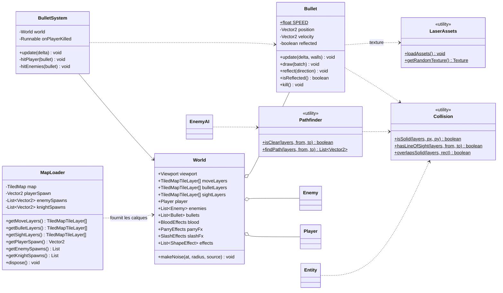

`World` est volontairement **passif** : il regroupe l'état partagé (calques, joueur, ennemis, balles, effets) pour éviter de
passer cinq paramètres à chaque `update`. Les trois tableaux de calques correspondent à trois questions différentes :
« qui bloque mon corps ? » (`moveLayers`), « qui bloque une balle ? » (`bulletLayers`), « qui bloque ma vue ? » (`sightLayers`).

---

## 6. Écrans et gestion du temps

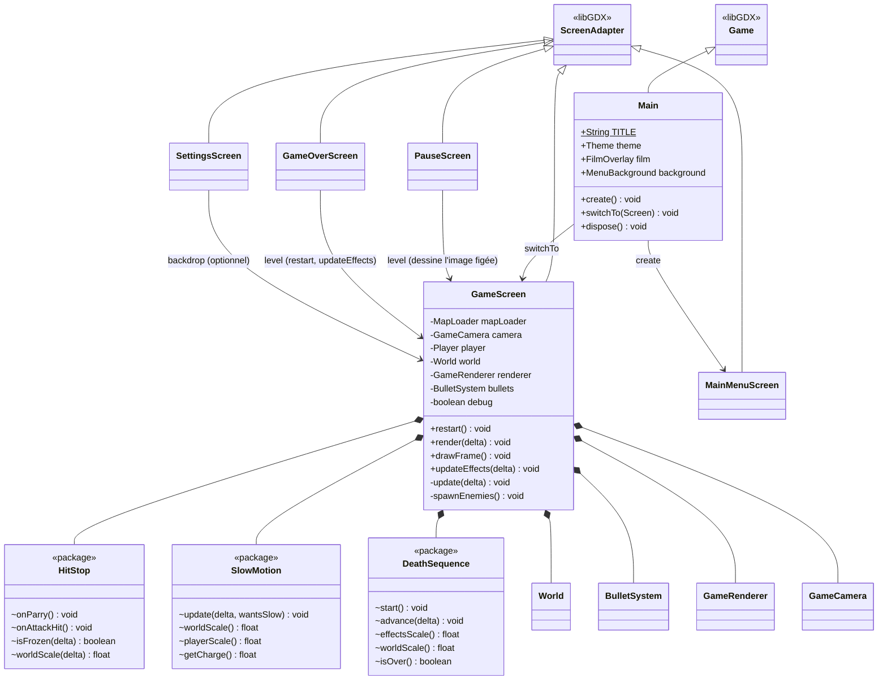

**Gestion du temps** : trois sources d'échelle de temps se combinent dans `GameScreen.update`.

| Source | Effet sur le joueur (`live`) | Effet sur le monde (`worldDt`) |
|---|---|---|
| `SlowMotion` (touche maintenue) | ×0,6 | ×0,2 |
| `DeathSequence` (joueur mort) | effets figés 0,06 s | ×0,25 |
| `HitStop` (coup / parry) | tout figé 0,06–0,09 s | puis ×0,3 pendant 0,35 s (parry) |

Les effets visuels (`ShapeEffect`) avancent au **temps réel** (`delta`), pour continuer à s'animer pendant un arrêt sur image.

---

## 7. Rendu et effets

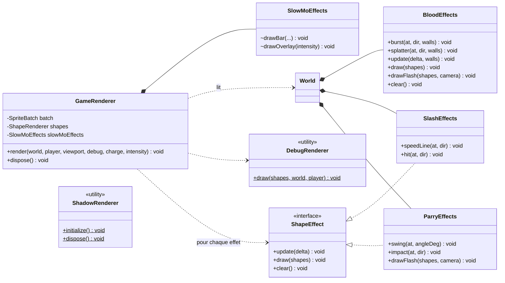

**Ordre de dessin** dans `GameRenderer.render` (du dessous au dessus) :

1. carte Tiled → 2. sang au sol → 3. cônes de vision → 4. points de charge des tireurs →
5. sprites (ennemis puis joueur) → 6. lasers → 7. indicateurs d'alerte + `ShapeEffect` + flashs →
8. jauge et voile de ralenti → 9. hitbox de debug (si `F1`).

---

## 8. Interface et réglages

```mermaid
classDiagram
    direction LR

    class Theme {
        +titleStyle
        +hintStyle
        +button(text, centered) TextButton
        +spaced(String)$ String
        +dispose() void
    }
    class FilmOverlay {
        +draw(delta, projection, dim, vignetteAlpha) void
    }
    class MenuBackground {
        +render(delta, projection) void
    }
    class Crosshair {
        +apply() void
        +restore()$ void
    }
    class GameSettings {
        <<static>>
        +float musicVolume$
        +float sfxVolume$
        +boolean fullscreen$
        +load()$ void
        +save()$ void
        +pressed(Action)$ boolean
        +justPressed(Action)$ boolean
        +setKey(Action, int)$ void
    }
    class Action {
        <<enumeration>>
        UP
        DOWN
        LEFT
        RIGHT
        DASH
        SLOWMO
    }
    class GameCamera {
        +centerOn(position) void
        +shake(amount) void
        +update(delta, playerPos, mapW, mapH) void
        +resize(w, h) void
    }

    MenuBackground --> FilmOverlay
    GameSettings +-- Action
    Main --> Theme
    Main --> FilmOverlay
    Main --> MenuBackground
    GameScreen --> Crosshair
    GameScreen --> GameCamera
    PlayerInput ..> GameSettings
```

---

## 9. Diagramme d'états : IA ennemie

Vue d'un ennemi (le tireur et le chevalier partagent ces états ; seule l'attaque diffère).

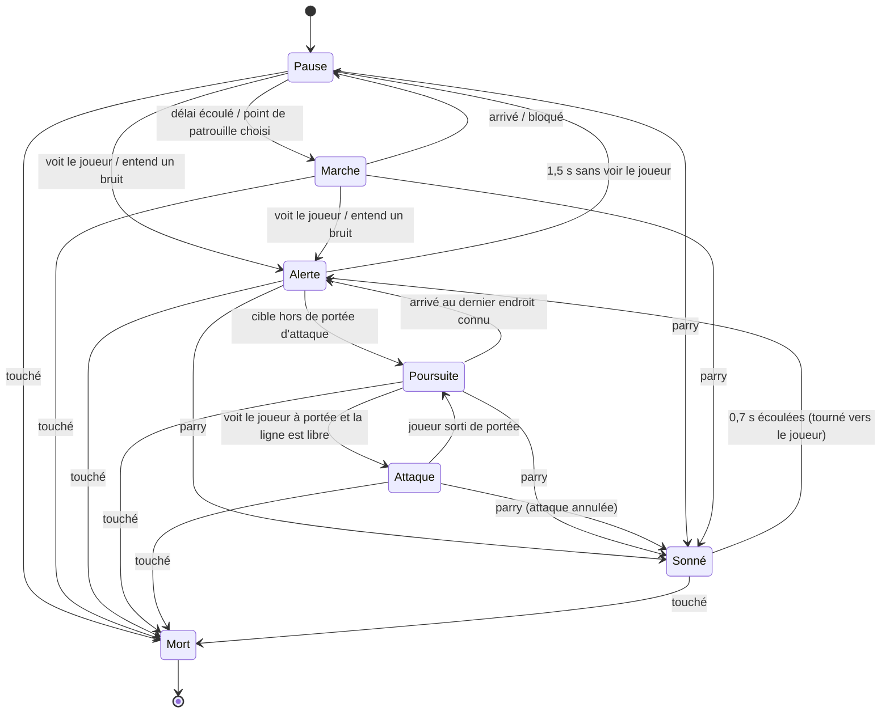

États réellement stockés : `alerted`, `walking`, `chasing` (dans `EnemyAI`), `Stun.timer`, `isAlive()` (dans `Character`).
Le diagramme est la lecture logique de ces drapeaux.

Machine à états du **joueur** (pendant le `Dash` il est invincible : un tir ou un coup ne le fait pas passer à `Mort`) :

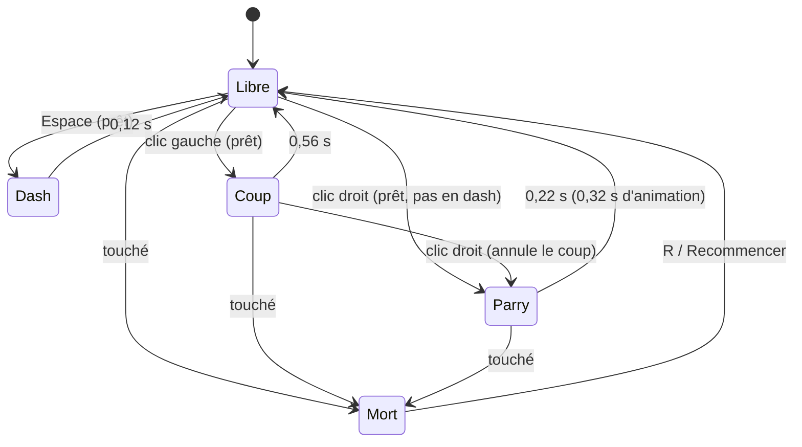

---

## 10. Diagrammes de séquence

### 10.1 Une image de jeu (`GameScreen.render`)

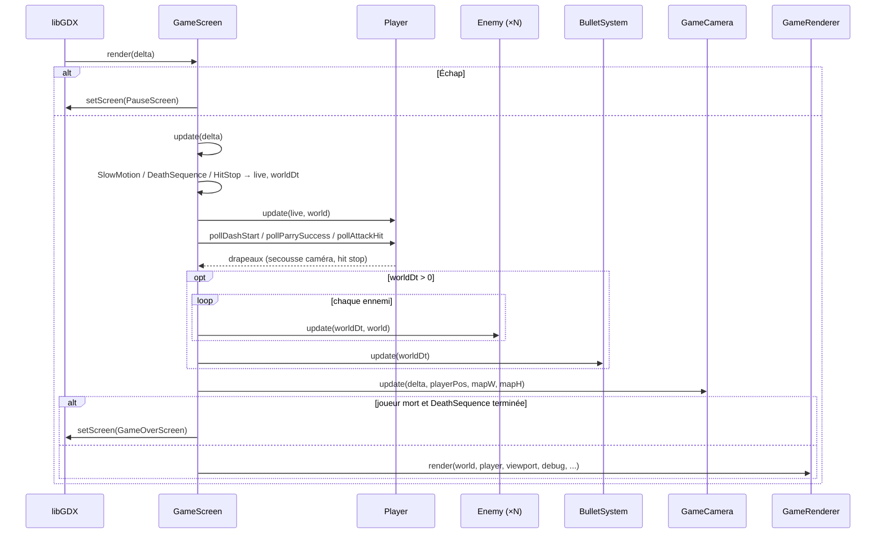

### 10.2 Un parry réussi contre un tireur

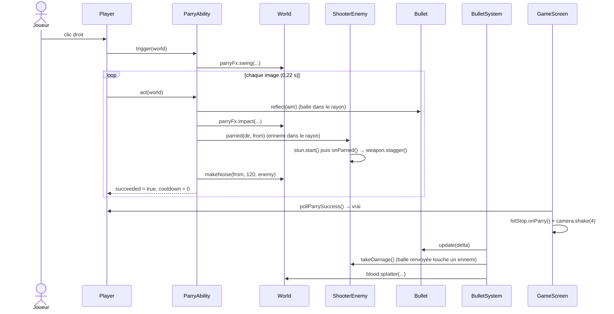

### 10.3 Mort du joueur

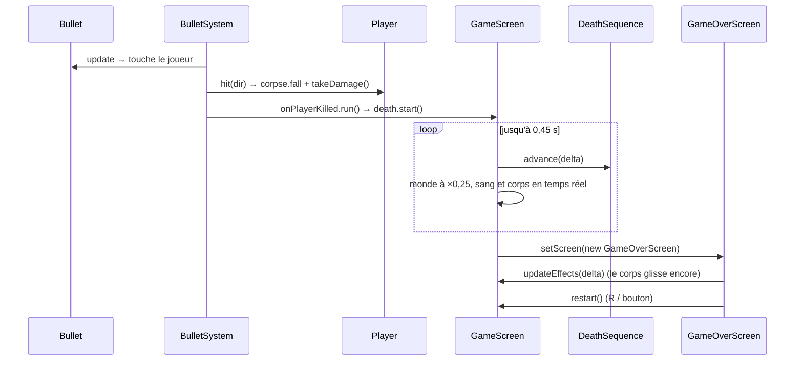

### 10.4 Poursuite d'un ennemi avec A\*

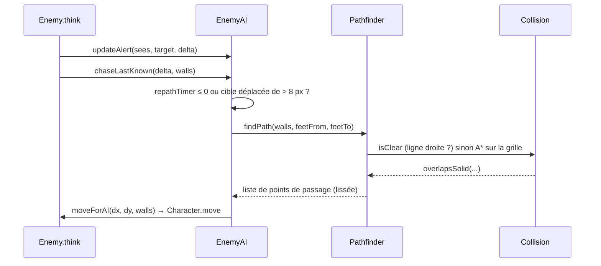

---

## 11. Extension prévue : boss final

Non implémenté (voir [`BOSS.md`](BOSS.md)) : voici où il s'insère sans modifier l'existant.

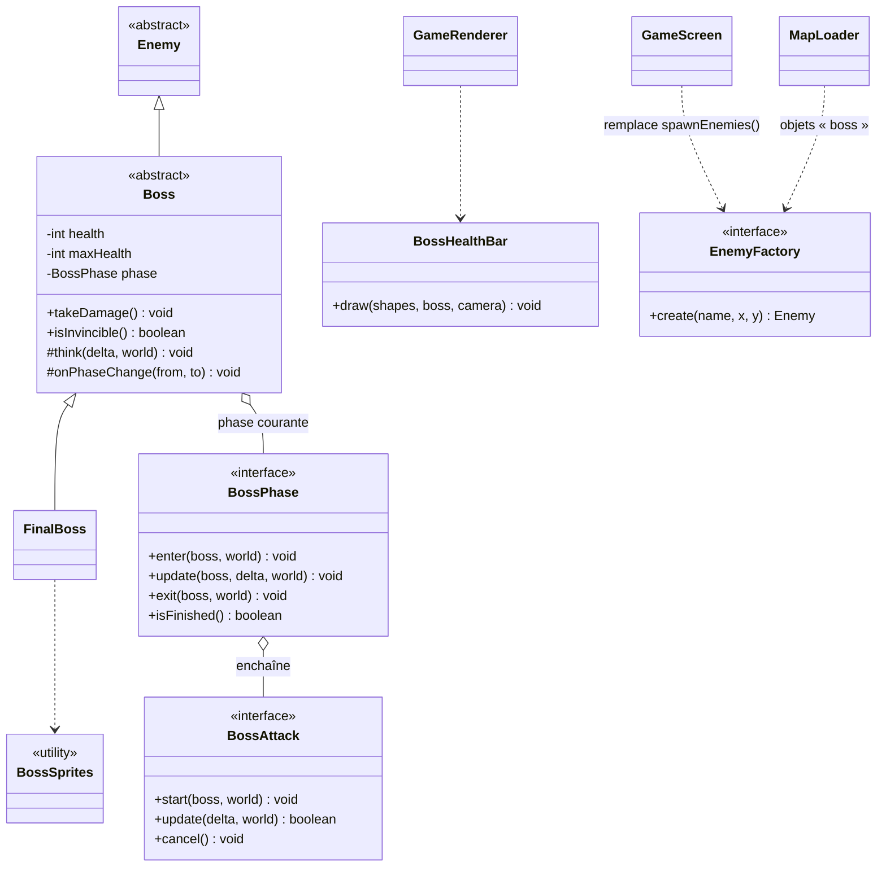
